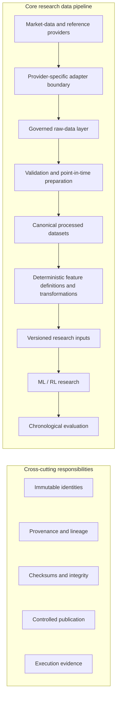

# Data Architecture Overview

QTRP defines a provider-neutral, reproducible research-data architecture for chronological ML/RL evaluation. The diagram shows the **intended logical flow**, not a deployed or end-to-end operational pipeline. [PROJECT_CONTEXT.md](../../PROJECT_CONTEXT.md) controls current lifecycle and authorization state.

## Logical data flow

Arrows express **logical data dependencies**, not current executable integration. The cross-cutting artifact responsibilities apply to the relevant outputs and evidence; they are not a separate market-data processing stage.

## Responsibilities and engineering rationale

- **Provider boundary and raw data.** Provider-specific adapters translate external formats into governed, provider-neutral contracts while retaining source objects, field mappings, feed and timestamp semantics, reference snapshots, and retrieval lineage. Provider neutrality enables downstream reuse, **not** scientific interchangeability: a material source change can require dataset reconstruction and affected research reruns.
- **Preparation and processed data.** Calendar/session checks, expected slots, source availability, security identity, corporate actions, missingness, and as-of constraints govern canonical, non-model-specific processed records. Point-in-time eligibility prevents current listings or later revisions from being backcast into historical decisions. The accepted primary experimental universe is a characterized and frozen **42 securities**; formation-population completeness has not been established.
- **Features and research inputs.** Deterministic formulas, ordering, timing, windows, and versioned input identities make transformations traceable. Feature availability must precede the decision it informs; training-fitted preprocessing and forward-dependent outcomes must respect chronological partition boundaries. Processed data remains distinct from model-specific observations and fitted preprocessing.
- **Research and evaluation.** The planned bounded model families consume common, versioned inputs and share chronological evaluation assumptions, including a separately protected final holdout. These are prospective research responsibilities, not evidence of trained or qualified models.
- **Cross-cutting evidence.** Immutable source, dataset, configuration, split, feature, and output identities; checksums; lineage; and controlled, verifiable publication enable reconstruction and comparison. Publication integrity is distinct from scientific dataset acceptance or model qualification.

Dependencies run from governed configuration/data toward features, models, and evaluation; artifact utilities support these layers without selecting providers, deciding model quality, or authorizing execution. Provider, model, evaluation, and execution implementations must not be reverse-coupled into data or feature boundaries.

## Implementation maturity

| Level | Current position |
| --- | --- |
| **Accepted architectural contracts** | C2 subsystem/dependency boundaries and C5 provider strategy are documented; the C6 dataset contract is frozen and effective, and the 42-security primary universe is accepted and fixed. |
| **Implemented offline components** | Selected source modules provide narrow offline capabilities, including historical symbol-representation checks, deterministic diagnostic utilities, and atomic checksummed publication of caller-supplied dataset bundles. These modules do **not** establish a connected ingestion-to-research pipeline or scientific acceptance. |
| **NONPRODUCTION qualification** | Isolated reliability and component verification exist, with documented limitations. Batch0004 reliability engineering is a separate execution-integrity workstream, not an additional logical research-data stage or proof of scientific readiness. |
| **Future / not authorized** | Provider-access establishment is still pending acceptance. C7 dataset generation and acceptance, production feature generation, model training or qualification, final-holdout evaluation, paper trading, and deployment are not authorized or completed. |

## Authoritative references

- [Project Context](../../PROJECT_CONTEXT.md) — controlling current state and authorization boundaries.
- [C2 Repository Skeleton and Boundaries](C2_canonical_repository_skeleton_and_boundaries.md) — subsystem ownership and dependency direction.
- [C5 Provider Strategy Decision](../decisions/C5_provider_strategy_decision.md) — provider-neutral contract versus source-specific scientific semantics.
- [C6 Dataset Contract](C6_dataset_contract.md) and [C6 Completion Decision](../decisions/C6_completion_decision.md) — frozen schemas, chronology, identities, leakage controls, and completion status.
- [Data](../../src/quantitative_trading_research/data/README.md), [Features](../../src/quantitative_trading_research/features/README.md), and [Artifacts](../../src/quantitative_trading_research/artifacts/README.md) — subsystem-specific responsibility boundaries.

This overview explains existing architecture; it grants no new authorization.
